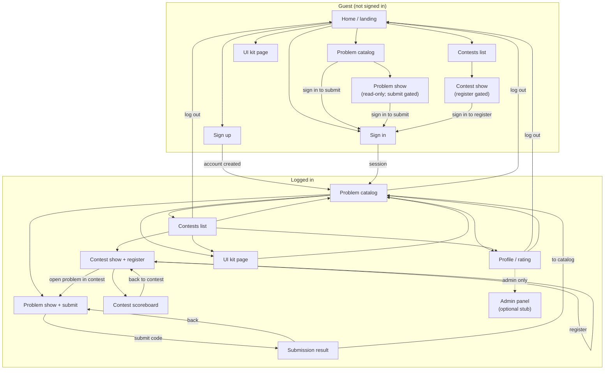

# ThetaRush: project specification

Source of truth for product naming, screens, stack, and risks. Architecture details: [architecture.md](architecture.md). Milestones: [milestones.md](milestones.md).

---

## 1. Topic name and description

**Project name:** ThetaRush

**Description:** ThetaRush is a competitive programming website where people practice algorithmic problems, compete in timed contests, and track their skill over time. Users browse a problem catalog, submit solutions in Python or C++, and receive automated verdicts from an isolated judge. Contests use ICPC-style scoring; after a contest ends, participant ratings update with a Codeforces-style Elo system. Profiles show current rating and history. An admin panel supports managing problems and contests.

**Core user goals:**
- Solve practice problems and see Accepted / Wrong Answer / TLE / RE (and similar) results
- Join contests, submit under contest rules, and follow the scoreboard
- See personal rating and how it changes after contests finish

---

## 2. Screen diagram with transitions

Screens below are the planned product surface (guest vs logged-in). UI kit is a review/gallery page for Milestone 3, not a core product flow. Admin is an optional stub, not a full CMS design.

**Transition notes:**
- Catalog -> problem -> submit -> result is the practice loop; guests can read problems but must sign in to submit.
- Contest -> register -> contest problems -> submit -> scoreboard is the contest loop; scoreboard may require a full page refresh until Milestone 7 (live updates).
- Auth: sign up / sign in create a session that survives refresh; log out ends it (Milestone 2).
- UI kit is linked for course review; it does not alter product state.

---

## 3. Technology stack

Aligned with [architecture.md](architecture.md). Nothing below is installed yet; this is the planned stack.

### Frontend

| Piece | Choice |
|-------|--------|
| Rendering | Server-rendered HTML from Rails views |
| Navigation / partial updates | Hotwire **Turbo** (Drive, Frames; Streams from M7 for live scoreboard) |
| Light client behavior | Hotwire **Stimulus** controllers |
| Styling | Custom CSS with CSS variables and shared tokens (approach finalized in M3 UI kit; not a SPA CSS framework) |
| Live updates (M7) | ActionCable + Turbo Streams on the contest scoreboard |

No separate SPA framework (React/Vue/etc.). The browser speaks HTTP (and WebSocket for cable) to Rails.

### Backend and application

| Piece | Choice |
|-------|--------|
| Framework | Ruby on Rails |
| Auth | Devise (registration, login, cookie sessions) |
| Admin | Administrate (thin panel) |
| Background jobs | Sidekiq (+ sidekiq-cron for scheduled contest generation / finalize later) |
| Domain services | Judge0Client, Contests::Generator, Contests::Scoring, Ratings::Calculator, Problems::Importer |

### Data and infra

| Piece | Choice |
|-------|--------|
| Primary DB | PostgreSQL |
| Queue / cable | Redis |
| File storage for tests | ActiveStorage and/or disk |
| Code judging | Judge0 CE in Docker (isolate sandbox) |
| Judged languages | **Python** and **C++** only |

### Offline import (support path)

Hugging Face / contest datasets filtered by a Python script into JSON + test files, then `rake import:problems` into Rails. Not required for early milestones beyond seeded fixtures.

---

## 4. Pitfalls

Concrete risks to keep in mind in later milestones. Mitigations are planning notes only; do not implement workarounds that weaken security.

### Problem datasets and licensing

- Public datasets (e.g. open-r1/codeforces, CodeContests, TACO) vary in quality: broken tests, missing expected output, or statements that do not match tests.
- Licensing and redistribution may restrict shipping raw dumps in the repo. Prefer a small curated fixture set for demos; keep large dumps out of git.
- Import must validate that stdin/expected pairs exist before a problem goes live. Never "fix" expected outputs to make a submission pass.

### Judge0 CE operations and callbacks

- Judge0 needs its own Docker stack (API, workers, PostgreSQL, Redis). Local ports and env must stay separate from the Rails app DB/Redis.
- Webhooks/callbacks from Judge0 must reach Rails. On a laptop that often means careful callback URLs, Docker networking, or temporary polling during bring-up.
- Worker backlog, timeouts, and CE version quirks can leave submissions stuck in `queued`. Need clear failure/timeout handling later.
- Language IDs in Judge0 must map cleanly to our Python/C++ allowlist; reject anything else at the app boundary.

### ICPC scoring and penalty edge cases

- Wrong attempts before first AC add penalty; re-solving after AC must not double-count.
- Contest time boundaries: submissions after end should not update standings.
- Ties, freeze windows (if any), and first-AC bonuses need explicit rules before coding Contests::Scoring.
- Practice submissions (no contest) must not touch contest standings.

### Elo / rating updates

- Rating should update only after contest finalize, not on every verdict mid-contest.
- Edge cases: single participant, all ties, newcomers with default rating, contests with zero solves.
- Formula must be deterministic and unit-tested (M4) before jobs wire it (M5).
- Do not recompute ratings from partial or non-contest submissions.

### Sandbox security (host vs Judge0)

- **Never run untrusted user submissions on the host** (no `eval`, no host `system`/`Open3` for contestant code). All execution goes through Judge0 isolate.
- Do not weaken Judge0 sandbox limits (CPU, memory, network, process) for convenience or to make tests green.
- Keep Rails and Judge0 process boundaries clear so a compromised submission cannot touch app data.

### Webhook authenticity and local network exposure

- An open webhook endpoint can be spoofed locally if there is no shared secret, token, or network restriction. Plan a basic authenticity check suitable for local Judge0 (documented in M5).
- Binding Judge0 or Sidekiq UI to `0.0.0.0` without auth is unsafe on shared networks; prefer localhost for development.
- Do not commit real credentials, callback secrets, or production URLs into the repo.

---

## Milestone 1 checklist (spec deliverables)

- [x] Project topic name and description
- [x] Screen diagram with transitions
- [x] Technology stack (frontend explicit)
- [x] Pitfalls (datasets, Judge0, scoring, rating, sandbox, webhooks)
